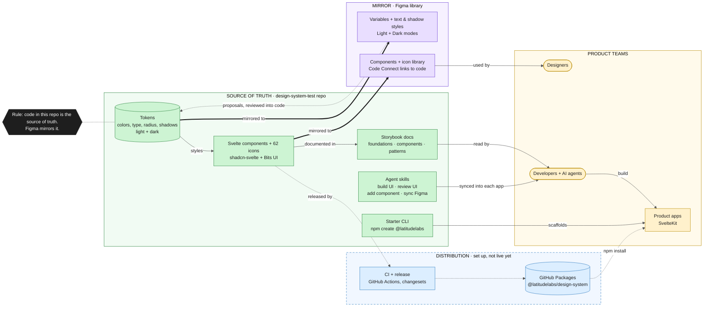

# Latitude design system

One set of foundations and components for every internal product, so each new product starts on-brand,
accessible and consistent instead of rebuilding buttons from scratch.

- **Foundations**: color, typography, radius, elevation, spacing and the brand accent.
- **Components**: built on [shadcn-svelte](https://shadcn-svelte.com) and [Bits UI](https://bits-ui.com), styled for Latitude.
- **Patterns**: how components combine into real screens.

The code in `@latitudelabs/design-system` is the source of truth. The Figma library mirrors it.

## How it fits together



**Thick** arrows: the source of truth flowing into its mirror (code to Figma). **Dotted**: a proposal, or set up
but not live yet. **Thin**: everyday use. The diagram is drawn live from the Mermaid source in this page's
Markdown (`apps/docs/src/guides/getting-started.md`); edit it there.

## Start a new product

The CLI scaffolds a SvelteKit app with the design system, fonts and registry access already configured:

```bash
npm create @latitudelabs@latest my-product
```

## Add to an existing SvelteKit app

**1. Point the `@latitudelabs` scope at GitHub Packages.** Add an `.npmrc` to the project root:

```ini
@latitudelabs:registry=https://npm.pkg.github.com
//npm.pkg.github.com/:_authToken=${GITHUB_TOKEN}
```

`GITHUB_TOKEN` needs the `read:packages` scope (a personal access token locally; the built-in Actions token in CI).

**2. Install** the package and Tailwind (the design system ships Tailwind v4 styles):

```bash
npm install @latitudelabs/design-system
npm install -D tailwindcss @tailwindcss/vite
```

**3. Add the Tailwind plugin** in `vite.config.ts`:

```ts
import tailwindcss from '@tailwindcss/vite';
import { sveltekit } from '@sveltejs/kit/vite';
import { defineConfig } from 'vite';

export default defineConfig({ plugins: [tailwindcss(), sveltekit()] });
```

**4. Import the stylesheet once**, in your root layout CSS. It includes Tailwind, the Inter font and all tokens:

```css
@import '@latitudelabs/design-system/theme.css';
```

**5. Use components:**

```svelte
<script lang="ts">
	import { Button, Card } from '@latitudelabs/design-system';
</script>

<Card.Root>
	<Card.Header>
		<Card.Title>Insights</Card.Title>
		<Card.Description>Ready when at least 10 responses</Card.Description>
	</Card.Header>
	<Card.Content>
		<Button>Share</Button>
	</Card.Content>
</Card.Root>
```

## Icons

A curated set of 62 Lucide icons ships with the design system. Browse them in **Foundations → Icons**.

```svelte
<script lang="ts">
	import { Icon, Search } from '@latitudelabs/design-system/icons';
</script>

<Icon icon={Search} />
```

## AI agent skills

The package includes agent skills that teach AI coding agents (Claude Code and others that read `.claude/skills`)
to build with the design system:

- **latitude-ui**: which components exist, which tokens to use, proven page patterns.
- **latitude-ui-review**: an audit (`node .claude/skills/latitude-ui-review/scripts/audit.mjs src`) that flags
  hardcoded colors, bold text, off-scale values, direct Lucide imports and more, with the fix for each.

Apps created with `npm create @latitudelabs` sync them into `.claude/skills/` on every install. In an existing app,
add `"postinstall": "latitude-skills"` to your `package.json` scripts.

## Dark theme

Every color role has a dark value. Toggle it with a `dark` class on `<html>`. The simplest way to follow the
user's system setting (and remember their choice) is [mode-watcher](https://mode-watcher.svecosystem.com):

```bash
npm install mode-watcher
```

```svelte
<!-- src/routes/+layout.svelte -->
<script lang="ts">
	import { ModeWatcher } from 'mode-watcher';
	import '../app.css';

	let { children } = $props();
</script>

<ModeWatcher />
{@render children()}
```

Then `toggleMode()` / `setMode('dark')` from `mode-watcher` switch themes. Don't hand-pick dark colors
(`dark:bg-[#222]`): the roles already handle it.

## Rules of thumb

- **Use semantic tokens, never raw values.** Write `bg-card text-muted-foreground`, not `bg-white text-[#6a6a6a]`.
  Raw values are how products drift apart.
- **Prefer an existing component over a new one.** If something is missing, propose it to the design system
  instead of building a one-off. Your product's need is probably someone else's too.
- **Keep the UI monochrome.** Black is the accent. The brand gradient is reserved for AI and brand moments.
- **Don't override component styles to change their meaning.** `class` is for layout (width, margin), not for
  restyling a Button into something else.

## Updating

The package follows semantic versioning. Patch and minor releases are safe to take anytime. Major releases come
with a migration note in the changelog.
