# Docs

## Design system overview

How the pieces of the Latitude design system relate. **Code in this repo is the source of truth; the Figma library
mirrors it.**



| File | Use |
|---|---|
| `design-system-overview.mmd` | Mermaid source. Edit this; GitHub renders it too. |
| `design-system-overview.svg` | Vector export for docs, Notion, Confluence. |
| `design-system-overview.png` | 2× image for Slack and slides. |

Re-render after editing the source:

```bash
npx -y @mermaid-js/mermaid-cli -i docs/design-system-overview.mmd -o docs/design-system-overview.svg -b white
npx -y @mermaid-js/mermaid-cli -i docs/design-system-overview.mmd -o docs/design-system-overview.png -b white -s 2
```

Or paste the `.mmd` contents into https://mermaid.live to edit visually and export.
