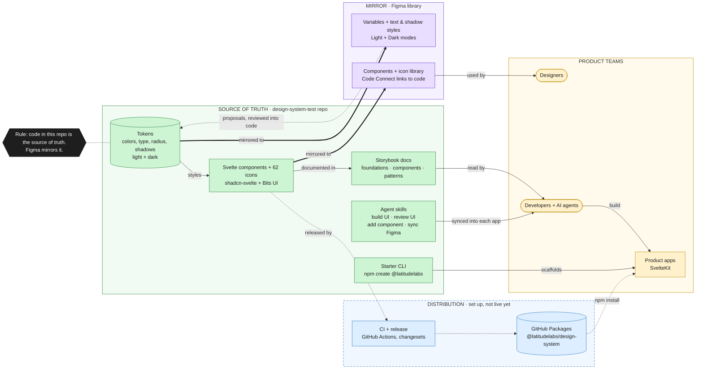

# How the Latitude design system fits together

**Code in this repo is the source of truth. Figma mirrors it.** Designers propose changes in Figma; once reviewed,
they land in the tokens and components here and are synced back to Figma.



| Line | Meaning |
|---|---|
| **Thick** | Source of truth flowing into its mirror (code → Figma) |
| Dotted | A proposal, or something set up but not live yet (releases, GitHub Packages) |
| Thin | Everyday use |

## Editable source

Exports: `design-system-map.svg` (vector), `design-system-map.png` (2×, Slack and slides), `design-system-map.pdf`
(chart only, one page sized to the diagram).

Edit `design-system-map.mmd` (Mermaid) and re-render the images:

```bash
npx @mermaid-js/mermaid-cli -i docs/design-system-map.mmd -o docs/design-system-map.svg -c docs/mermaid.config.json -b white
npx @mermaid-js/mermaid-cli -i docs/design-system-map.mmd -o docs/design-system-map.png -c docs/mermaid.config.json -b white -s 2
npx @mermaid-js/mermaid-cli -i docs/design-system-map.mmd -o docs/design-system-map.pdf -c docs/mermaid.config.json --size 1700x600
```

You can also paste the source into https://mermaid.live to tweak it and export PNG/SVG.


